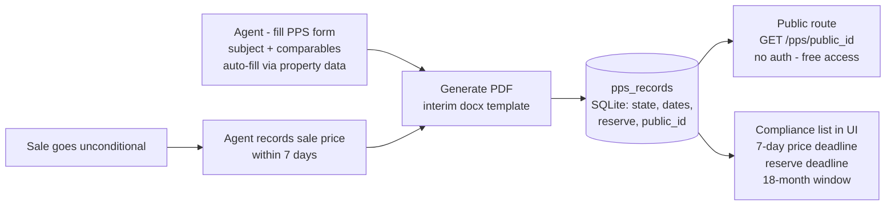

# feat: Property Price Statement (PPS) — SOI replacement for residential sales

## Goal Capsule

Prepare forms-fill for Victoria's Property Price Statement, the intended replacement for the sales Statement of Information under the Consumer Legislation Amendment Bill 2026 (target commencement 1 October 2026). Scope per user direction: **generate + track** — the PPS document itself, auto-filled comparables from property data, and the compliance-workflow pieces forms-fill can own (sale-price update within 7 days, 18-month public publication, reserve-price fields). Advertising display on portals stays outside the app.

---

## Product Contract

### Summary

Forms-fill has **no sales SOI today** (the similarly named registered form is the rental-applicants statement), so the PPS is a new form plus a new compliance-record lifecycle. Because the Bill **has not passed Parliament** as of 2 September 2026 — no Royal Assent, no regulations, no CAV-approved form, and REIV formally opposes it — the plan splits into work that is safe to build now (interim template from the Bill's stated requirements, data model, tracking, public page) and a gated finalisation unit that lands only once the law, regulations, and official template exist.

### Problem Frame

- From the target date, every residential sale internet ad must display a PPS adjacent to the price, with key features of the subject and each comparable property — the old SOI's address-and-price format is insufficient.
- New ongoing obligations attach to each sale: sale price added within 7 days of unconditional; the PPS publicly accessible for free for at least 18 months after sale; vendor reserve published for auctions and fixed-date sales (at least 7 days prior — a hard stop on the auction if missed).
- The exact prescribed feature list, comparable-selection rules (whether the SOI's 3-comparables / 6-months / 2 km metro rules carry over), penalties, and transitional treatment of existing listings are **not yet public**.

### Requirements

- **R1** A new `property_price_statement` form generates a PPS PDF containing: indicative selling price; subject property key features (building type, bedrooms, bathrooms, car spaces, internal floor area m², land size m²); and for each comparable property the same key-feature set plus address, sale price, and sale date. Layout is an interim in-house template until the CAV-approved form exists (see R8).
- **R2** Comparable slots (3 by default, matching the current SOI convention, adjustable when regulations land) can be auto-filled from a property-data source, with every value editable by the agent before generation; manual entry works with no data source configured.
- **R3** Each generated PPS creates a persistent **PPS record** with lifecycle state: draft → published (advertising live) → sold-unconditional (+sale price) → archived (18 months after sale). Status and deadlines are computed on read — no background scheduler.
- **R4** The record captures: unconditional date and sale price, with the 7-day deadline surfaced (due-in-N-days / overdue) and the document regenerated with the sale price on update.
- **R5** Auction / fixed-date sales carry a vendor reserve price and its publication date; the UI surfaces the "publish at least 7 days before the auction/fixed-date" deadline.
- **R6** Each PPS record has a **public, unauthenticated, free** URL serving the current PPS document (unguessable id), remaining accessible for at least 18 months after the sale date.
- **R7** The forms-fill UI lists PPS records with their compliance status (price-update due/overdue, publication-until date, reserve-publication deadline) for signed-in agents.
- **R8** The legislated specifics are finalised in a gated pass once available: swap in the CAV-approved template, encode prescribed features and comparable-selection rules, and confirm commencement/transition handling. Until then the interim document carries a discreet "prepared to Bill requirements; official form pending" note.

### Scope Boundaries

**In scope:** the new form + record lifecycle + public route in `forms_fill/`; interim template; property-data autofill client with manual fallback.

**Out of scope:** pushing the PPS into portal/website advertising (realestate.com.au etc.); retiring or altering any existing form; automated reminder emails (deadline visibility is in-app only for now).

### Deferred to Follow-Up Work

- Reminder emails/Telegram for approaching 7-day and reserve deadlines (needs a real scheduler; `send_invite_email` is the only mail path today).
- Bulk PPS refresh tooling for listings advertised before commencement, if transition rules require it.
- Guided-wizard opt-in for the PPS form (reuse the lease wizard's `guided` flag once the form settles).

---

## Planning Contract

### Key Technical Decisions

1. **KTD1 — docx interim template, not PDF overlay.** No official PDF exists to stamp, so an in-house docx template (like the CAV forms the repo already renders via `render.py`) is the interim vehicle; when CAV publishes the approved form, R8 swaps the template and, if it's a fixed PDF, moves to the `pdf_overlay` engine following `reiv_exclusive_sale_authority/spec.py`.
2. **KTD2 — PPS records get their own SQLite table**, not drafts: the lifecycle outlives a fill session (18+ months), needs queryable deadline fields, and serves a public route. Follows the `accounts.py` table/CRUD pattern; deadline status is compute-on-read via the existing `_iso_in`/`_expired` idiom (session-settled: no scheduler exists in the package and none is added).
3. **KTD3 — Property-data client in `providers/`** as a new module speaking the everyproperty API (credentials via env), returning a `PropertyFacts` shape (beds/baths/cars/floor/land/building type) for subject + comparables. The existing `TenancyBundle` providers are rental-shaped and are not extended. Manual entry is the zero-config path (R2).
4. **KTD4 — Public route serves by unguessable UUID with no auth**, modelled on `get_file` minus `_require_auth`, path-guarded like the existing `request_id` handling. No listing/index endpoint — a URL is only knowable from the record.
5. **KTD5 — Phased delivery with a hard regulatory gate** (session-settled: user-directed — chosen over waiting for the official template: interim-now/swap-later). U1–U6 are buildable now; U7 is blocked on Royal Assent + regulations + CAV form and must not be guessed at.
6. **KTD6 — Compliance warnings via `validate_warnings`**, the existing non-blocking hook (used for the s47A ≤10% range check on the sale authority) — e.g. fewer than 3 comparables, missing reserve for an auction sale, indicative price outside comparable range.

### Assumptions

- The SOI's comparable conventions (3 comparables, sold within 6 months, within 2 km metro) are the sensible interim default; regulations may change them (R8 encodes the final rules).
- The everyproperty API is reachable server-side with credentials the user can supply; if not, manual entry remains fully sufficient for launch.
- Railway hosting serves the public route at a stable URL suitable for the 18-month obligation.

### High-Level Technical Design

---

## Implementation Units

### U1. PPS form spec and interim template

- **Goal:** the `property_price_statement` form exists, renders, and is catalogued under GEA Sales.
- **Requirements:** R1, R8 (interim note), KTD1, KTD6.
- **Dependencies:** none.
- **Files:** `forms_fill/forms_fill/forms/property_price_statement/spec.py`, `forms_fill/forms_fill/forms/property_price_statement/template.docx` (new), `forms_fill/forms_fill/registry.py`, `forms_fill/tests/test_pps.py` (new), `forms_fill/tests/test_forms_catalogue.py`.
- **Approach:**
  1. Author the interim docx template from the Bill's stated content: header, indicative price, subject-property feature table, three comparable blocks (address, sale price, sale date, feature set), median-price section mirroring the current SOI shape, reserve-price line for auction/fixed-date, and the "official form pending" note.
  2. Spec follows `reiv_exclusive_sale_authority` for sales context (`build_sales_context`, `requires_bundle=False`) but with the docx engine; declare caller fields with kinds/sections/help so the form is wizard-ready later.
  3. `validate_warnings`: <3 comparables filled; auction/fixed-date chosen without a reserve; indicative price outside the min–max of entered comparable prices.
  4. Register in `FORM_REGISTRY`, `_SALES_KEYS`, `_SHORT_TITLES`.
- **Patterns to follow:** `forms/reiv_exclusive_sale_authority/spec.py` (sales context, warnings), `forms/cav_rent_increase_notice/` (docx text ops).
- **Test scenarios:**
  - Catalogue lists the form under GEA Sales with its declared fields/kinds/sections.
  - Fill round-trip produces a docx→PDF containing subject features and all three comparables.
  - Warning fires for 2 comparables; none for 3.
  - Auction sale without reserve price produces the reserve warning.
- **Verification:** full pytest green; generated document visually checked once.

### U2. Property-data client and comparables autofill

- **Goal:** one search fills subject + comparable key features; everything editable; absent credentials degrade to manual.
- **Requirements:** R2, KTD3.
- **Dependencies:** U1.
- **Files:** `forms_fill/forms_fill/providers/property_data.py` (new), `forms_fill/forms_fill/api.py`, `forms_fill/forms_fill/static/index.html`, `forms_fill/tests/test_property_data.py` (new).
- **Approach:**
  1. `property_data.py`: thin client for the everyproperty API (env `EVERYPROPERTY_API_*`), functions `property_facts(address)` and `comparable_sales(address, limit=3)` returning dataclasses with the six key features + sale price/date.
  2. New endpoint `/property/facts` (auth-required) the PPS form's UI calls; response seeds the form fields via the existing `seedField`/source-tag machinery so provenance and manual-edit precedence work unchanged.
  3. No credentials → endpoint returns a clear "not configured" state; UI hides the autofill button.
- **Execution note:** stub the HTTP layer in tests (fixture provider pattern in `providers/fixture.py`); do not call the live API from tests.
- **Test scenarios:**
  - Facts endpoint maps a stubbed API payload to the field names U1 declares.
  - Missing credentials → "not configured" response, no exception.
  - API error → clean error payload; form remains fillable manually.
- **Verification:** pytest + `node --check` green; manual: one autofill against the live API when credentials are present.

### U3. PPS record lifecycle and persistence

- **Goal:** every generated PPS creates a durable record with computed compliance status.
- **Requirements:** R3, R4, R5, KTD2.
- **Dependencies:** U1.
- **Files:** `forms_fill/forms_fill/accounts.py`, `forms_fill/forms_fill/api.py`, `forms_fill/tests/test_pps_records.py` (new).
- **Approach:**
  1. Table `pps_records(id, public_id, agent_id, address, state, created_at, sale_method, reserve_price, reserve_published_at, auction_date, unconditional_at, sale_price, sale_price_recorded_at, document_request_id, updated_at)`.
  2. CRUD in `accounts.py` following the drafts pattern. The PPS fill payload carries an optional `pps_record_id`: absent → create a new record with a fresh `public_id`; present → update that record and repoint `document_request_id` at the new fill's request id (U5's record-sale-price action passes the id explicitly). `agent_id` is nullable — machine-token/dev-auth fills store NULL.
  3. Endpoints: list (agent-scoped), get, update (record unconditional date + sale price → regenerates the document via the normal fill path; set reserve/auction fields).
  4. Status computed on read: `price_update_due` (unconditional_at + 7 days), `reserve_due` (auction_date − 8 days — conservative clear-days reading until U7 confirms the enacted wording), `public_until` (unconditional_at + 18 months — interim proxy for "sale date"; U7 reconciles the statutory trigger), each with due/overdue flags — `_iso_in`/`_expired` idiom, no scheduler. Deadline durations live as named constants so U7 can change them in one place.
- **Test scenarios:**
  - Fill creates a record with a fresh `public_id`; refill updates the same record.
  - Sale price recorded 8 days after unconditional → overdue flag true; within 7 → due-in-N.
  - Reserve deadline computed correctly against auction_date; missing reserve on an auction record flags.
  - `public_until` is unconditional date + 18 months.
- **Verification:** pytest green; API round-trip exercised in tests.

### U4. Public free-access route

- **Goal:** anyone with the link can view the current PPS document, free, no auth.
- **Requirements:** R6, KTD4.
- **Dependencies:** U3.
- **Files:** `forms_fill/forms_fill/api.py`, `forms_fill/tests/test_pps_public.py` (new).
- **Approach:** `GET /pps/{public_id}` — no `_require_auth`; validates the UUID shape (isalnum guard as per `get_file`), 404s unknown ids, serves the record's current PDF inline with a minimal HTML wrapper (address, state, generated date). Archived records (past `public_until`) still serve until explicitly removed — the 18-month rule is a minimum; no pruning path exists by design. **Deployment prerequisite:** `FORMS_OUTPUT_DIR` must point at the Railway persistent volume before this ships — the generated PPS file is the only copy of the served document.
- **Test scenarios:**
  - Unauthenticated GET returns the document for a valid id.
  - Unknown/malformed id → 404 without information leakage.
  - Sale-price update regenerates and the public URL serves the updated document (same URL).
- **Verification:** pytest green; manual: open the public URL in a private browser window on the deployed app.

### U5. Compliance list in the UI

- **Goal:** signed-in agents see every PPS record and its deadlines at a glance.
- **Requirements:** R7.
- **Dependencies:** U3, U4.
- **Files:** `forms_fill/forms_fill/static/index.html`, `forms_fill/tests/test_ui_routes.py`.
- **Approach:** a "Price statements" panel (visible when the PPS form is selected or from a small standing link): list records with address, state, and the three computed deadlines with due/overdue text badges (not colour alone); actions — open public link, record sale price, set reserve. Reuse the drafts-banner list styling. The panel carries a standing note: "Shows only price statements generated here; no reminders are sent — check deadlines after every unconditional." (an aid, not an assurance).
- **Test scenarios:**
  - Page contains the panel markup and deadline badge logic (string-assertion convention).
  - Record-sale-price action wires to the U3 update endpoint.
- **Verification:** pytest + `node --check` green; manual walk of record → update → public link.

### U6. Compliance-date advice in output

- **Goal:** the generated document and UI carry the operative dates so agents act correctly per sale.
- **Requirements:** R1, R4, R5.
- **Dependencies:** U1, U3.
- **Files:** `forms_fill/forms_fill/forms/property_price_statement/spec.py`, `forms_fill/forms_fill/static/index.html`.
- **Approach:** field help (`caller_field_help`) carries the obligations inline ("Sale price must be added within 7 days of unconditional", "Reserve must be published at least 7 days before the auction — the auction cannot proceed otherwise"); the record view shows the concrete computed dates. Echo-style only — no auto-computed dates enter form fields.
- **Test scenarios:** help text published via the catalogue for the deadline-bearing fields.
- **Verification:** pytest + `node --check` green.

### U7. Regulatory finalisation (GATED — do not start until triggers fire)

- **Goal:** replace interim assumptions with the legislated specifics.
- **Requirements:** R8, KTD5.
- **Dependencies:** U1–U6; **external triggers:** (a) Royal Assent + commencement proclamation, (b) regulations naming prescribed features and comparable rules, (c) CAV-approved PPS form published.
- **Files:** `forms_fill/forms_fill/forms/property_price_statement/` (template/spec), `forms_fill/forms_fill/accounts.py`, `forms_fill/forms_fill/api.py`, `forms_fill/forms_fill/static/index.html`, possibly the `render_overlay.py` path if the official form is a fixed PDF.
- **Approach:** swap the template; reconcile the field set against prescribed features; encode final comparable-selection validation; confirm the enacted 7-day price-update, reserve-publication (calendar vs clear days), and 18-month accessibility durations and the "sale date" trigger, updating the compute-on-read constants and help text; remove the "official form pending" note; confirm transition handling for pre-commencement listings and adjust guidance text.
- **Test scenarios:** existing U1 tests updated to the final field set; a diff of interim-vs-final fields recorded in the PR.
- **Verification:** pytest green; document matches the CAV form side-by-side.

---

## Risks & Dependencies

- **The Bill may not pass, may be amended, or may slip past 1 October 2026.** As of 2 Sep 2026 it is in committee in the Legislative Council; REIV opposes it; the premier's resignation adds political uncertainty. U1–U6 remain worth building as preparation, but the interim PPS is **preparatory only**: before commencement it may supplement — never replace — the prescribed Statement of Information, and the SOI continues to be issued for every listing until the checkpoint confirms the new regime is in force.
- **Prescribed features and comparable rules are unknown** — the six features listed in industry summaries may not match the final regulations. U7 owns reconciliation; U1's field declarations keep features data-driven so changes are cheap.
- **Public-route durability is architectural, not just operational:** generated PDFs live under `FORMS_OUTPUT_DIR` (default `./out`), which is ephemeral in the container — SQLite alone surviving a redeploy still 404s every public URL, a statutory-breach outcome. U4 requires `FORMS_OUTPUT_DIR` on the Railway persistent volume (or a volume-backed copy-on-generate), and the Definition of Done verifies a public URL survives a redeploy. No backup/export exists for the volume; periodic export is deferred follow-up.
- **everyproperty API availability/credentials** — R2's manual path removes this as a launch blocker.

---

## Operational Notes — dates the agency must have in place

Working to the target commencement of **1 October 2026** (unconfirmed — see Risks):

| Date | What must be true |
|---|---|
| **by 15 Sep 2026** | U1–U6 built and deployed; agents trained on the PPS flow; REIV training reviewed. |
| **~15–22 Sep 2026** | **Checkpoint:** verify Royal Assent, commencement proclamation, regulations, and CAV form (legislation.vic.gov.au + Government Gazette + CAV forms page). Fire U7 if published; if commencement slips, keep issuing SOIs and hold. |
| **by 23 Sep 2026** | Reserve-price workflow live: any auction/fixed-date sale on or after 1 Oct needs its reserve published at least 7 days prior — for an auction on 1 Oct, publish by 23 Sep on the conservative clear-days reading (U7 confirms the enacted wording). |
| **by 30 Sep 2026** | Every live residential listing's advertising refreshed with a PPS adjacent to the price (transition rules unpublished — conservative default is to refresh everything). |
| **1 Oct 2026** | PPS mandatory on new internet advertising; SOI retired for new listings; 7-day sale-price and 18-month publication clocks begin. |
| **ongoing** | Sale price within 7 days of each unconditional; PPS public for 18 months after each sale. |

---

## Verification Contract

| Gate | Command | Applies to |
|---|---|---|
| Full test suite | `.venv/bin/python -m pytest tests -q` (from `forms_fill/`) | U1–U6 |
| Page script syntax | `node --check` on the inline script of `forms_fill/forms_fill/static/index.html` | U2, U5, U6 |
| Manual walk | generate a PPS, record a sale price, open the public URL unauthenticated | U1, U3, U4, U5 |

---

## Definition of Done

- U1–U6 landed; pytest and `node --check` green; a PPS generated end-to-end with auto-filled comparables (or manual), record tracked, public URL serving.
- Deadline flags demonstrably correct for the 7-day, reserve, and 18-month windows.
- U7 explicitly parked with its three external triggers documented; interim document carries the "official form pending" note.
- A PPS public URL generated before a redeploy still serves after the redeploy (persistent-volume check).
- No existing form's behaviour changed.

---

## Sources & Research

- Repo: `forms/reiv_exclusive_sale_authority/spec.py` (sales context + warnings pattern), `accounts.py` (tables, compute-on-read expiry), `api.py` (auth surfaces; `get_file` shape for the public route), registry/guided-flag mechanics. The registered "statement_of_information_applicants" form is the rental statement — no sales SOI exists in the repo.
- Web (2 Sep 2026): REIV Bill overview (reiv.com.au), Hansard (Bill in LC committee 13 Aug 2026), eliteagent.com (REIV opposition), madgwicks.com.au / dottandcrossitt.com.au / baysideadvocacy.com.au / tickboxconveyancing.com.au (obligation summaries), consumer.vic.gov.au forms page (still 2019 SOI forms; no PPS template). Load-bearing: the Bill-not-passed finding created KTD5's gate and the Operational Notes checkpoint; the no-template finding created KTD1.

**Product Contract preservation:** n/a — bootstrap plan, no upstream requirements document.
